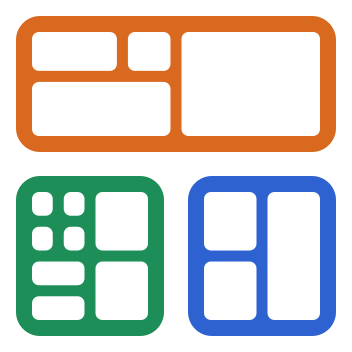

<p align="center">
  
</p>

<h1 align="center">tri.scrnz</h1>

A lightweight Windows desktop app for testing Android devices over USB. It gives you one tab per device, with a clickable live mirror of the main screen, the customer screen when one is detected, and a filtered logcat panel.

Built with Tauri 2 (Rust and React/TypeScript). It talks to the adb server that is already running on `127.0.0.1:5037`, and it mirrors screens with scrcpy-server 5.0.1.

## Features

- **Device tabs.** One tab per connected device or emulator, with a live mirror you can click, type and scroll in, plus Back, Home, Recents, power, volume and rotate buttons.
- **Customer screen.** A second (presentation) display is detected and mirrored next to the main screen, view-only.
- **All devices.** Every device as a tile on one board. Drag a tile by its header, resize it from any side, drag the divider between its two screens, hide the devices you don't need there, and record the whole board as one MP4.
- **Logcat.** Live, filtered by level, tag, text or regex, and by the app you pick.
- **Capture.** Screenshots (saved and copied to the clipboard) and MP4 recordings of any screen.
- **Files.** A tree of the device's files with upload, download, new folder and delete, including app data of debuggable apps.
- **Apps.** Drop an `.apk` on a screen to install it; restart, force-stop or clear the data of the selected app.
- **Terminal.** A device shell, or a terminal in a project folder that already targets the device (`ANDROID_SERIAL` is set and the SDK's adb comes first on `PATH`). Choose PowerShell, Git Bash or Command Prompt. React Native and Expo projects start building right away.
- **Emulators.** Create emulators from your installed system images (phone, tablet and POS terminal profiles or a custom screen, optionally with a customer screen as a second display), then quick boot, cold boot, wipe, stop or delete them. Emulators run without a window and open as tabs like devices.

## Install

1. Install the Android SDK platform-tools (they come with Android Studio). tri.scrnz uses the SDK's adb and never ships its own. It finds the SDK through `ANDROID_HOME`, `ANDROID_SDK_ROOT` or `%LOCALAPPDATA%\Android\Sdk`.
2. Download the installer (`tri.scrnz_<version>_x64-setup.exe`) from the [Releases](https://github.com/rddolor27/k3-scrnz/releases) page and run it. The installer is not code-signed, so Windows SmartScreen may ask you to confirm.
3. Turn on USB debugging on the device, connect it over USB and accept the debugging prompt.

Requires Windows 10 or 11 with the WebView2 Runtime (part of Windows 11; the installer downloads it on Windows 10 if it is missing).

## Build from source

You need:

- Windows 10/11 with the WebView2 Runtime
- Visual Studio Build Tools 2022 ("Desktop development with C++")
- Rust stable with the MSVC toolchain (`rustup default stable-msvc`)
- Node.js 24 and pnpm 10
- Android SDK platform-tools

### Develop

```sh
pnpm install
pnpm tauri dev
```

### Build

```sh
pnpm tauri build
```

The NSIS installer is written to `src-tauri/target/release/bundle/nsis/`.

## License

tri.scrnz is licensed under the [Apache License 2.0](LICENSE). The installer ships `LICENSE` and `NOTICE` next to the app.

## Third-party

`src-tauri/resources/scrcpy-server-v5.0.1` is the unmodified server from [scrcpy](https://github.com/Genymobile/scrcpy) v5.0.1 (Copyright (C) 2018 Genymobile, Copyright (C) 2018-2026 Romain Vimont; Apache License 2.0). Its SHA-256 is `764eb6f79811d5211fe9df341120882ba9994c7a61b897d7bf3fb662e53bc536`. See [NOTICE](NOTICE).
